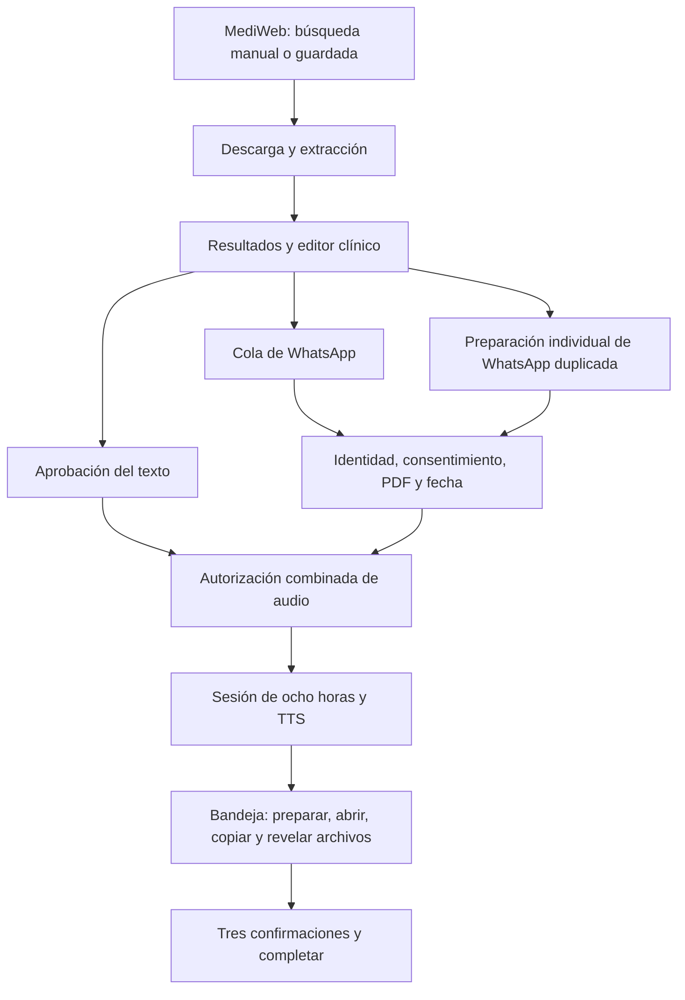
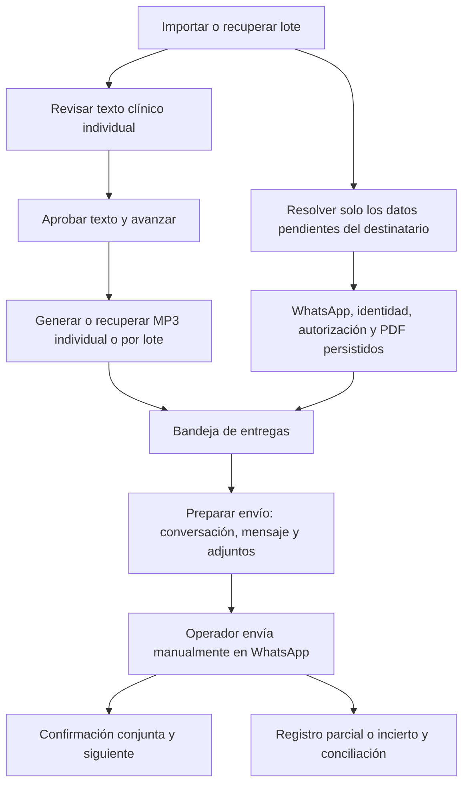

# AudioEvaluaciones: auditoría y simplificación del trabajo

Fecha: 18/10/2026. Rama: `ux/flujo-operativo-simplificado`.
Base actualizada: `origin/main`, commit `9d90e4e`. Sin despliegue, publicación ni cambios en los almacenes médicos existentes. Se conservó la modificación local previa de `.gitignore`.

## Diagnóstico y mapa anterior

El problema principal era la dependencia circular entre revisión clínica, verificación del destinatario y audio. La misma autorización condicionaba el botón de síntesis, la cola masiva, la recuperación y la vigencia de respuestas pendientes. La interfaz reflejaba ese acoplamiento en controles administrativos dentro del editor clínico.



### Pantallas y relaciones inspeccionadas

| Área | Componentes y dependencias | Hallazgo |
|---|---|---|
| Entrada y recuperación | `App.jsx`, `evaluationPersistence`, `batchState` | Historial, importación, acceso TTS y cola masiva ocupaban el espacio anterior a la revisión. Selección y filtros no se persistían juntos. |
| Importación | `MediwebImporter`, `IntegratedProcessing`, `mediwebUiState`, `importMediwebPdf`, servicio HTTP y `processingFlow` | Conviven procesamiento integrado y descarga anterior por pasos, esta última ya secundaria. Se conserva la búsqueda manual, la comprobación de resultados y el diario contra descargas duplicadas. Tras importar, iniciar otro procesamiento seguía teniendo demasiado protagonismo. |
| Revisión | `PdfWorkersPreview`, `PdfWorkerReviewForm`, motor clínico y `clinicalApproval` | Editor, autorización de entrega y preparación de archivos estaban mezclados. Había una segunda comprobación de WhatsApp dentro del editor, además de la cola especializada. Los once filtros y las estadísticas de teléfonos saturaban el panel. |
| Destinatario | `WhatsAppReviewQueue`, `recipientReview`, `authorizationPolicy`, `recipientPolicy` | «Tiene WhatsApp» podía guardar solo existencia. Guardar además identidad, consentimiento y PDF exigía tres casillas, una fecha y otra casilla para persistirlas. `canDeclare` exigía abrir el chat incluso si ya existía una comprobación válida. |
| Audio individual y masivo | `BulkAudioPanel`, `bulkAudio`, `evaluationPersistence`, `audioRequestGuard` | `getAudioAuthorization` exigía `recipientVerified`; el cliente verificaba físicamente el PDF antes de TTS. Los tokens de cola, las huellas y la aceptación de respuestas incluían datos del destinatario. Revocar permisos o cambiar teléfono inutilizaba el MP3. |
| Sesión de audio | `TtsSessionPanel`, `ttsAccessClient`, `ttsSession`, `ttsAccess`, rutas Vercel y middleware de Vite | La cookie firmada ya era HttpOnly, pero duraba ocho horas y el acceso se presentaba como un panel independiente. No era necesario sustituir el modelo de autenticación ni exponer un token al cliente. |
| Entrega | `DeliveryInbox`, `deliveryUx`, `deliveryService`, rutas `/deliveries` | La preparación se iniciaba al seleccionar, y luego el operador ejecutaba apertura, copia, dos revelados, tres declaraciones y finalización. La selección podía mostrar registros ajenos al filtro. Faltaba una declaración manual explícita de resultado incierto desde un estado listo. |
| Archivos | `managedFiles`, `temporaryAttachments`, `encryptedOutput`, `evaluationStore`, rutas de archivos | Los originales siguen protegidos. La caducidad corresponde a copias legibles, no al PDF original ni al MP3 persistente. El texto visible no explicaba suficientemente la recuperación. |
| Componentes anteriores | `SheetsWorkspace`, `RecordsTable`, `DetailPanel`, `Tabs`, `UploadZone` | Existen como flujo anterior, pero el `App` actual no los monta. No se reactivaron ni se modificó su arquitectura sin necesidad. |
| Estilos | `index.css`, `App.css`, estilos de formulario | Ya existían variables institucionales, pero coexistían botones nativos sin tratamiento, grandes superficies, reglas específicas y estadísticas técnicas. Se reutilizó el sistema CSS sin librerías nuevas. |

### Causas concretas de los bloqueos

1. `clinicalApproval.getAudioAuthorization`: `approved && !clinical.blocked && recipientVerified`.
2. `App.handlePersistentAudio`: refrescaba contactos y validaba el PDF completo antes de pedir audio.
3. `reconcileWorkerReview`, `synchronizeRecipients`, `recordWhatsAppDecision` y la recuperación: trasladaban cambios o vencimientos de entrega a `audio_stale`.
4. `audioFingerprintPayload`, `approvalToken` y la comprobación de respuestas: vinculaban el MP3 al teléfono y a las declaraciones de entrega.
5. `WhatsAppReviewQueue`: abrir chat era condición para guardar, incluso con WhatsApp confirmado; el guardado de autorización era una elección adicional fácil de omitir.
6. `getRecipientChecks`: exigía una fecha futura para toda autorización de evaluaciones persistentes. La aplicación no tenía un catálogo institucional de plazos; introducir una fecha no demostraba por sí mismo que fuera real.
7. Las rutas de entrega comprobaban archivos, identidad y autorización correctamente, pero presentaban cada operación como un botón independiente y sus faltantes como un mensaje genérico.

### Datos guardados y reutilización deficiente

- WhatsApp y la autorización ya estaban dentro del catálogo cifrado. El problema no era la ausencia general de persistencia, sino las condiciones de reutilización y los caminos de guardado separados.
- Los MP3 tenían diario duradero y referencias recuperables, pero podían marcarse obsoletos por cambios administrativos.
- La cola de WhatsApp persistía posición, filtro y visitados. La revisión general no persistía su búsqueda, filtro y evaluación seleccionada.
- Los originales PDF no se habían eliminado al vencer una copia. Repetir la descarga no era necesario; bastaba revelar una copia nueva desde el archivo administrado.

### Cambios recientes y archivos temporales

`temporaryAttachments.js` se incorporó en el commit `3a9b0fd` de la serie 0.6.0-rc.2. La implementación conserva PDF cifrados con el formato `AED1` y catálogo/audio con AES-GCM y clave protegida por DPAPI. `managedFiles.revealPinned` obtiene los bytes protegidos, comprueba su huella y prepara una copia legible privada. Un vigilante limita su vida a 15 minutos y vuelve a intentar limpiar archivos bloqueados.

Este diseño evita depender de copias clínicas legibles permanentes y facilita equipos donde no puede usarse EFS. La conclusión se apoya en el código de protección y en sus pruebas; no presupone la intención personal del autor. No se revirtió esta protección. Vencida una copia, el sistema puede preparar otra con los mismos bytes, sin MediWeb ni TTS. Si la protección o la integridad no pueden comprobarse, falla de forma explícita.

## Flujo nuevo



### Interacciones antes y después

Los siguientes son recuentos de controles de AudioEvaluaciones, no mediciones de tiempo. Excluyen lectura clínica, tecleo, selectores de fecha del sistema y las acciones dentro de MediWeb, Explorer o WhatsApp.

| Tarea | Antes | Ahora |
|---|---|---|
| Generar audio con texto aprobado y WhatsApp pendiente | Bloqueado | 1 acción de generación; entrega pendiente |
| Revisar un texto y avanzar | Aprobar + seleccionar siguiente: 2 | Aprobar y siguiente: 1 |
| Guardar existencia y autorización conjuntamente desde la cola | Hasta 8 controles: abrir chat, desplegar, tres casillas, vencimiento, casilla de guardado y confirmar | Abrir chat cuando falte, una declaración conjunta, seleccionar la vigencia real y guardar: 4 controles principales; si existe vencimiento se ingresa su fecha real |
| Reutilizar comprobación válida de WhatsApp | Podía requerir reabrir el chat para guardar la autorización | 0 reaperturas de comprobación; solo se resuelve lo pendiente |
| Entrega completa de un trabajador listo | 9 acciones incluyendo selección; 10 si se preparaba manualmente | 3: seleccionar, preparar envío, confirmar completo y siguiente |
| Iniciar generación masiva tras revisar la estimación | Preparar + iniciar + ventana de confirmación: 3 | Calcular + generar con estimación visible: 2 por lote |
| Recuperar audio existente | Podía quedar bloqueado por destinatario o TTS de configuración | Recuperación desde almacén; ninguna nueva síntesis |

La apertura de la conversación para enviar sigue siendo necesaria. No es una nueva comprobación de existencia de WhatsApp.

## Cambios funcionales

### Audio y prevención de cargos duplicados

- La generación requiere extracción correcta, aprobación del texto exacto, validación clínica y acceso TTS. Se eliminaron las condiciones de teléfono, consentimiento y PDF de entrega.
- Cambiar teléfono, revocar la entrega o aplazar WhatsApp conserva la aprobación clínica y la vigencia del MP3 si su contenido sigue igual.
- Los tokens de cola se vinculan a la aprobación clínica. El contrato nuevo de huella excluye al destinatario.
- Los MP3 anteriores con metadatos de aprobación se recuperan por su misma operación cifrada cuando coinciden evaluación, aprobación única, texto y configuración. No se migra el audio mediante otra síntesis.
- Se conservan la reserva duradera anterior a TTS, la exclusión por evaluación, el diario de operaciones y el bloqueo de reintentos de resultado incierto.
- Se puede recuperar audio guardado y preparar entregas cuando la consulta de configuración TTS esté temporalmente fuera de servicio, utilizando la configuración del MP3 que el Connector comprueba. Esto no habilita síntesis anónima.

### WhatsApp y autorización

- Se mantiene el comprobador existente. Una evidencia válida permite guardar autorización sin volver a abrir el chat.
- Una declaración explícita conjunta guarda identidad, autorización real de canal y correspondencia documental en una operación; comprobar solo WhatsApp sigue sin conceder esos permisos.
- El esquema 3 vincula la autorización a la evaluación y versión del destinatario. Permite registrar una fecha real o declarar expresamente que la autorización está limitada a esa evaluación y no tiene vencimiento establecido.
- No se precargan fechas ficticias, plazos institucionales ni casillas de consentimiento. Las autorizaciones antiguas siguen respetando su vencimiento; las revocaciones no se convierten en permisos ni se renuevan automáticamente.
- Un teléfono compartido entre identidades distintas conserva la comprobación individual adicional.
- La bandeja enumera cada faltante. «Revisar o corregir evaluación» conduce directamente al destinatario cuando sus datos están pendientes.

### PDF, MP3 y entrega

- Se conservan cifrado, originales, referencias opacas, verificación de identidad del PDF y huellas de archivos.
- «Preparar envío por WhatsApp» agrupa preparación, apertura de conversación, copia de mensaje y disponibilidad de PDF/MP3. No envía contenido.
- La confirmación conjunta requiere los preparativos registrados y una declaración explícita del operador. Guarda tres hechos de trazabilidad en una transacción y pasa al siguiente candidato.
- Las herramientas secundarias permiten volver a mostrar copias vencidas y registrar elementos enviados por separado. Un resultado parcial o incierto puede bloquear nuevos intentos hasta conciliarlo.
- Una entrega completada sigue necesitando un motivo explícito para reabrirse. No se borró historial ni se fabricaron acuses de WhatsApp.

### Sesión segura

La sesión firmada HttpOnly, SameSite=Strict y Secure sobre HTTPS dura ahora hasta 30 días. La contraseña solo se usa en la vinculación inicial; la clave del proveedor permanece en backend. No se escribe un secreto de acceso en localStorage, sessionStorage ni el código Vite. Cerrar sesión elimina la cookie del navegador; rotar la contraseña del backend invalida las firmas anteriores.

Es una sesión persistente del navegador, no una vinculación física del equipo ni un sistema nuevo de cuentas. Borrar cookies, vencer el plazo o cambiar la contraseña obliga a vincular de nuevo. Un token ya sustraído no dispone de revocación individual en este modelo; su duración máxima está acotada y la rotación global sigue disponible. La interfaz recuerda cerrar sesión en equipos compartidos.

## Rediseño visual y navegación

- Navegación breve: importar, revisar y entregas. La acción útil tras importar es revisar evaluaciones.
- Historial e importación permanecen secundarios al recuperar un lote; el historial se pliega al terminar la recuperación.
- El editor concentra revisión, aprobación y audio. Se eliminó la preparación individual duplicada de WhatsApp.
- La generación masiva queda debajo del trabajo individual; el acceso del equipo se presenta compacto cuando ya está autorizado.
- Datos del lote y saludo son desplegables. Los once filtros pasan a un selector. El resumen de destinatarios muestra confirmados, pendientes y conflictos reales.
- Búsqueda, filtro y evaluación seleccionada se guardan en `review_ui` dentro del lote cifrado y se recuperan al volver de entregas.
- Botones, campos, foco de teclado, superficies, espaciado y diseño móvil comparten las reglas CSS existentes. No se añadieron dependencias.

## Validación y evidencia

Pruebas con personas, documentos, números, catálogos y audio ficticios. Los archivos de prueba se crean en directorios aislados. Ninguna solicitud llegó a ElevenLabs, Hugging Face ni a un chat real.

| Escenario solicitado | Evidencia automatizada |
|---|---|
| 1. WhatsApp vigente | `workflow-simplification.test.js` y navegador: no vuelve a aparecer «Abrir WhatsApp» como comprobación para el contacto confirmado. |
| 2. Audio sin WhatsApp | Pruebas de autorización y persistencia; navegador genera un MP3 simulado sin verificación de canal. |
| 3. Destinatario autorizado | Restauración y sincronización conservan declaraciones. La bandeja prepara sin pedirlas de nuevo. |
| 4. Cambio de teléfono | Invalida evidencia de destinatario; conserva aprobación y huella de audio. |
| 5. Copia temporal vencida | Prueba específica de `temporary-attachments.test.js`: desaparece la copia antigua, se crea otra y el original permanece, sin descarga. |
| 6. Audio existente | Diario cifrado y pruebas de navegador: una solicitud sintética inicial y ninguna al recuperar; compatibilidad de huella anterior. |
| 7. Envío completo | Ruta HTTP real de `complete`: rechaza falta de preparación o declaración; registra confirmación conjunta atómica e idempotente. Navegador confirma y avanza. |
| 8. Recuperación y cambio de pantalla | Pruebas de catálogo cifrado y navegador verifican continuidad de evidencia, MP3, búsqueda y posición. |
| 9. Acceso TTS | Cookie firmada válida al día siguiente, rechazo de firma alterada, expiración a 30 días y rechazo de solicitudes anónimas. |

También se prueban cambios clínicos bloqueantes, extracción fallida, incertidumbre de síntesis, revocación, teléfonos en conflicto, archivos incorrectos y resultados parciales de entrega. Las pruebas anteriores que exigían WhatsApp para generar audio se actualizaron para exigir independencia y conservar el bloqueo de entrega.

Resultados finales: **249/249 pruebas de la aplicación**, **152/152 del Connector**, ESLint sin errores y compilación Vite correcta. La prueba de navegador terminó correctamente en ambos tamaños, con **una síntesis ficticia**, **cero solicitudes externas** y **cero errores de página**. También completó desde la bandeja el guardado conjunto de autorización limitada a la evaluación, sin introducir una fecha ficticia.

Ejecutables de validación:

```powershell
npm.cmd test
npm.cmd --prefix mediweb-downloader test
npm.cmd run lint
npm.cmd run build
node scripts/check-ux-browser.mjs
```

La prueba de navegador usa Edge headless instalado y Playwright ya presente. Comprueba escritorio de 1440 × 1000 y móvil de 390 × 844, ausencia de desbordamiento horizontal, errores de página y solicitudes externas. Las capturas y resultados están en `artifacts/ux/`.

## Vista previa segura

```powershell
node scripts/preview-ux.mjs
```

Abrir `http://127.0.0.1:4178`. El historial contiene un lote ficticio con dos trabajadores. La vista previa utiliza las rutas reales de almacenamiento y entrega sobre un catálogo temporal de prueba, comprobaciones de protección simuladas y un endpoint TTS exclusivamente local. No carga archivos `.env`, no utiliza el Connector instalado y no permite consumo de voz externo. Ctrl+C cierra la vista previa y limpia su fixture temporal.

El MP3 de esta vista previa es un contenedor sintético para verificar el contrato y la persistencia: no sirve para evaluar voz ni calidad acústica. El envío y Explorer se simulan en la prueba de navegador; no se afirma que WhatsApp haya recibido documentos. Las pruebas Windows existentes cubren DPAPI, ACL y la gestión de adjuntos protegidos, pero no sustituyen la aceptación manual del instalador actualizado en el equipo del operador.

## Intervención real pendiente

- Aceptación del operador sobre legibilidad y rapidez con el flujo habitual antes de autorizar un despliegue o distribuir un nuevo Connector. Esta entrega modifica fuentes y pruebas; no instala ni publica un ejecutable. La interfaz y el Connector deben distribuirse juntos: el Connector anterior no reconoce la confirmación conjunta ni el esquema nuevo de autorización.
- Cuando una autorización tenga una fecha institucional o documental real, el operador debe registrarla. Si falta consentimiento, identidad o resolución de un conflicto, el sistema sigue solicitando esa evidencia; no puede inferirla del teléfono ni de esta auditoría.
- La primera vinculación del navegador necesita la contraseña del operador ya configurada. No se necesita crear un servicio ni exponer un secreto nuevo.
